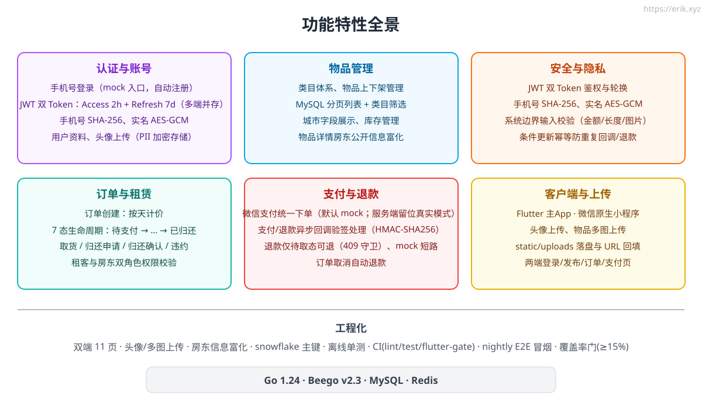
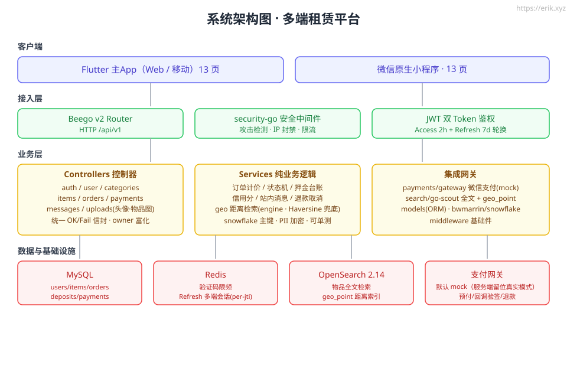
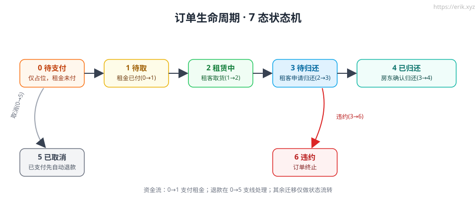

# 多端租赁平台 · item-rental

> 物品租赁**后端服务** — 发布、下单、支付与订单履约闭环。


**吉祥物 · 租租鼠** — 🐹 采用 **Go 官方 Gopher**(CC BY 4.0,Renee French 设计):本项目是 Go 1.24 后端,全球 Go 开发者一眼认出;戴上橙色安全帽 + 胸前 ¥ 徽章 + 怀抱送货箱,把「安全交付、按时归还、履约保障」写进造型。服务启动时控制台也会出现 Gopher(`/static/mascot.svg` 可见)。

---

## 项目介绍

一个面向 **Flutter 主App / 微信原生小程序**的 P2P 物品租赁平台。房东发布闲置物品并按天计价;租客浏览、下单、支付租金、取件使用、按约归还;平台以 7 态订单状态机贯穿租赁全流程,配套退款与违约处置。

技术底座:Go 1.24 + Beego v2.3(MVC)+ MySQL + Redis(可选);**主键 bwmarrin/snowflake**(JSON 字符串输出,JS 安全);phone 哈希 + 实名加密存储(ITEM_RENTAL_PII_KEY);微信支付网关抽象(默认 mock 预支付/验签回调/退款;服务端已留真实商户模式,客户端目前仅接入 mock)。双端前端:`apps/flutter`(11 页)与 `apps/wxapp`(11 页 ×4 件套,微信原生)。

## 功能特性



- **认证与账号**:手机号登录(mock 入口,新用户自动注册)、JWT 双 Token(Access 2h + Refresh 7d **多端并存、单端登出**轮换)、用户资料/实名(加密存储)/头像上传。
- **物品与发布**:类目体系、上下架、**多图上传**(POST /items/upload,≤9×4MB)、详情 owner 公开信息富化(昵称/头像)。
- **订单与租赁**:按天计价、7 态生命周期、取货/归还申请/归还确认/违约、双方角色权限校验。
- **支付与退款**:微信支付网关抽象(mock 预付/回调验签/退款;服务端留位真实商户模式,客户端目前仅 mock)、订单取消自动退款、**退款状态守卫**(仅待取可退,租赁中 409)。
- **安全与隐私**:phone sha256 + real_name AES-GCM(密钥 fail-fast)、统一边界校验、**主键 snowflake 字符串契约**(JS 安全)。

## 技术架构



| 层 | 组件 |
| --- | --- |
| 客户端 | Flutter 主App(移动/Web)· 微信原生小程序(11 页 ×4 件套) |
| 接入层 | Beego Router(方法感知鉴权) · CORS · JWT 双 Token |
| 业务层 | Controllers(统一信封) · Services(纯业务逻辑) · 集成网关(payments/models/middleware) |
| 数据与基础设施 | MySQL · Redis(可选) · 微信支付商户平台 · static/uploads |

## 订单生命周期



| 状态 | 含义 | 主要动作 |
| --- | --- | --- |
| 0 待支付 | 仅占位,租金未付 | — |
| 1 待取 | 租金已付 | 0→1 支付回调 |
| 2 租赁中 | 已取货 | 1→2 取货 |
| 3 待归还 | 租客申请归还 | 2→3 归还申请 |
| 4 已归还 | 完成归还 | 3→4 归还确认 |
| 5 已取消 | 退款租金 | 0→5 取消(退款) |
| 6 违约 | 订单终止 | 3→6 违约 |

资金流:0→1 支付租金;退款在 0→5 支线处理;其余迁移仅做状态流转。

## 项目结构

```
item-rental/
├── server/                  # Go 后端(Beego v2)
│   ├── main.go              # 入口
│   ├── conf/app.conf        # 配置(环境变量覆盖见 config-runbook)
│   ├── routers/router.go    # 路由与方法感知鉴权
│   ├── controllers/         # 控制器(统一 OK/Fail 信封)
│   ├── services/            # 纯业务逻辑(单据/计价/状态机/会话,可单测)
│   ├── models/              # ORM 模型 users/categories/items/orders/payments(snowflake 主键)
│   ├── payments/            # 支付网关抽象(预付/回调验签/退款,mock 默认)
│   ├── middleware/          # JWT 双 Token
│   ├── static/              # 静态资源(mascot.svg;uploads/ 上传目录)
│   └── *_test.go            # 离线单测,免基建
├── apps/flutter             # Flutter 主App(11 页)
├── apps/wxapp               # 微信原生小程序(11 页 ×4 件套)
├── deploy/                  # Docker Compose(dev/prod)、Schema、镜像
├── docs/                    # 架构/功能/生命周期 SVG、支付码、配置与规划文档
├── scripts/                 # push-release.sh(增量 tag + Release)、e2e-smoke.sh(E2E 冒烟真源)
└── .github/workflows/       # ci.yml(lint/test/flutter-gate)、nightly.yml(每日 E2E,mysql service)
```

## 使用说明

### 环境要求

- Go 1.24+;Docker + Docker Compose(mysql:8、redis:7;Redis 为可选依赖)
- 微信支付商户密钥(M3 证书;mock 模式不需要)

### 本地开发

```bash
# 1. 起基础设施(dev compose;若宿主机 3306 被占,设 MYSQL_HOST_PORT=3307)
docker compose -f deploy/docker-compose.yml up -d

# 2. 起服务(dev 自动建表)
#    必设 env:JWT 密钥 + PII 密钥(缺失 fail-fast panic);mock 支付可带 WECHAT_MOCK=1
cd server && ITEM_RENTAL_JWT_SECRET=<强随机串> ITEM_RENTAL_PII_KEY=<64hex> WECHAT_MOCK=1 go run .
```

冒烟验证(手机号直接登录,mock 入口):

```bash
# 登录得 token
curl -s -X POST http://127.0.0.1:8080/api/v1/auth/login -H 'Content-Type: application/json' \
  -d '{"phone":"13800138000"}'
# 发布物品(JWT)
curl -s -X POST http://127.0.0.1:8080/api/v1/items -H "Authorization: Bearer $TOKEN" \
  -H 'Content-Type: application/json' \
  -d '{"title":"单反相机","category_id":1,"daily_price":30,"stock":1}'
# 公开读详情(无需 token)
curl -s http://127.0.0.1:8080/api/v1/items/1
```

### 测试与构建

```bash
cd server && go build ./... && go vet ./... && go test ./... -count=1   # 离线全绿
```

### 生产部署

```bash
docker compose -f deploy/docker-compose.prod.yml up -d   # 端口覆盖 3307/16379
BEEGO_RUNMODE=prod ./server                 # 或容器内运行
```

> 必设密钥/env(缺失即 fail-fast):`ITEM_RENTAL_JWT_SECRET`、`ITEM_RENTAL_PII_KEY`、`WECHAT_MOCK=0` + 商户配置;多实例需 `redis_enabled=true`——完整键表与启动前必检见 [docs/config-runbook.md](docs/config-runbook.md);上线前置 gate 清单见 [docs/task.md §11](docs/task.md)。
> 端口占用等坑位详见 [docs/design.md](docs/design.md) 排查要点。

### 推送与版本发布(推送规则)

```bash
./scripts/push-release.sh            # 推送分支 → 读最新 tag → 增量 patch 版 tag + GitHub Release
./scripts/push-release.sh --minor    # 或 --major / --version v2.0.0
```

规则:读取仓库最高 `v*` tag(无则从 `v0.0.0` 起步)→ 推送当前分支代码 → 增量 bump 版本 → 打注解 tag 并推送 → `gh release create --generate-notes`(自动收录自上一 tag 以来的提交)。需 git 干净工作区,已存在的版本拒绝重复。

## API 概览

`Base URL: /api/v1`;除标注「公开」外均需 `Authorization: Bearer <AccessToken>`。

### 认证 / 用户

| 方法 | 路径 | 鉴权 | 说明 |
| --- | --- | --- | --- |
| POST | /auth/login | 公开 | 手机号登录(自动注册) |
| POST | /auth/refresh | 公开 | 双 Token 轮换 |
| GET / PUT | /user/profile | JWT | 查看 / 更新资料 |

### 类目 / 物品

| 方法 | 路径 | 鉴权 | 说明 |
| --- | --- | --- | --- |
| GET | /categories | 公开 | 类目列表 |
| GET | /items | 公开 | 物品分页列表(category_id) |
| GET | /items/:id | 公开 | 物品详情 |
| POST | /items | JWT | 发布物品 |
| PUT | /items/:id | JWT(owner) | 修改物品 |
| POST | /items/:id/offshelf | JWT(owner) | 下架(同步删索引) |

### 订单(全部 JWT)

| 方法 | 路径 | 说明 |
| --- | --- | --- |
| POST | /orders | 创建订单(status=0) |
| GET | /orders | 我的订单 |
| GET | /orders/:id | 订单详情(renter/owner) |
| POST | /orders/:id/pickup | 取货(1→2) |
| POST | /orders/:id/return_request | 申请归还(2→3) |
| POST | /orders/:id/return_confirm | 确认归还(3→4) |
| POST | /orders/:id/breach | 违约(3→6) |
| POST | /orders/:id/cancel | 取消(0→5,退款) |

### 支付

| 方法 | 路径 | 鉴权 | 说明 |
| --- | --- | --- | --- |
| POST | /pay/unifiedorder | JWT | 微信预付(JSAPI) |
| POST | /pay/refund | JWT(owner/renter) | 退款 |
| POST | /pay/notify | 回调验签 | 支付/退款结果回调 |

## 相关文档

- [docs/plan.md](docs/plan.md) — 项目规划与路线图
- [docs/task.md](docs/task.md) — 任务清单与状态
- [docs/design.md](docs/design.md) — 设计决策与排查要点
- [docs/api.md](docs/api.md) — API 接口文档(接口/请求/响应/错误码)
- [docs/config-runbook.md](docs/config-runbook.md) — 配置键与部署手册
- [docs/frontend-plan.md](docs/frontend-plan.md) — 前端页面规划(仅规划)

## 支持与打赏

项目由个人维护。如果它对你有帮助,欢迎支持 — 你的每一份心意都是持续维护的动力。💛

| 打赏方式 | 二维码 |
| --- | --- |
| 微信赞赏码 |  |
| 支付宝收款码 |  |

> 左侧为**微信赞赏码**,右侧为**支付宝收款码**,分别对应微信与支付宝应用内扫码。


## 开源版 vs 商业版

本项目同时维护开源精简版（本仓库）与商业版。开源版保留发布、浏览、下单、支付、退款、上传与订单履约闭环；商业版在此之上保留完整高价值模块与交付物料。下表按功能、安全、性能、数据、测试、部署、多端、扩展性等维度对比：

| 维度 | 开源版（本仓库） | 商业版 |
|---|---|---|
| 功能覆盖 | 认证/物品/订单/支付/上传闭环；6 个业务控制器、5 张表；不含营销站 | 同一基础闭环，另含搜索/geo、押金与信用分、站内消息、短信登录、安全防护；营销站、Flutter Linux runner、完整素材、小程序退款入口 |
| 安全防护 | JWT 双 Token、手机号 SHA-256、实名 AES-GCM、统一边界校验、密钥缺失 fail-fast | 同一套 + security-go 攻击检测/IP 封禁 |
| 性能与规模 | Go 1.24 + Beego v2.3、Redis 可选（refresh 会话）、MySQL 列表分页 | 同一套 + OpenSearch 全文/geo 检索 |
| 数据与检索 | MySQL 5 张表（users/categories/items/orders/payments） | 8 张表（另含 deposits/credit_events/messages） |
| 测试与质量 | Go 测试套件、Flutter test、CI（go test / flutter test） | 同一套代码与测试 |
| 部署与运维 | dev/prod docker-compose、initdb、config-runbook、健康检查、密钥 fail-fast | 同一套 + OpenSearch 编排 |
| 多端与国际化 | Flutter 11 页 + 微信小程序 11 页；中英 README | 同两端 + Linux 桌面 runner；营销站为 zh-CN 独立站点 |
| 扩展性与二次开发 | MVC 分层（controllers/services/models/middleware）、`docs/api.md`、配置 runbook | 同一套，另附营销站源码 |
| 授权与商业支持 | 个人学习/研究；商业使用需书面授权 | 商业授权交付；条款联系 erik@erik.xyz |
| 适用场景 | 学习/研究、二次开发、小规模自建 | 商业部署、需要完整功能/素材/交付支持 |

> 注：商业版 README 将支付/短信描述为“真实通道就绪”，但两版支付实现相同（mock 默认 + 真实模式预留）；短信登录仅商业版后端保留。

**商业版授权联系：erik@erik.xyz**

**English summary:** This repository is the trimmed open-source edition: auth, items, orders, payments, uploads and the order lifecycle, without search/geo, deposits/credit, in-app messaging, SMS login or the security-go WAF. The commercial edition keeps those modules and additionally ships the Flutter Linux desktop runner, the original mini-program refund entry, the full brand/donation assets, and a standalone zh-CN marketing site (`site/`, 24 files). Both editions use the same Go/Beego/MySQL/Redis base and mock-by-default payment gateway. Commercial licensing and delivery: erik@erik.xyz.

## 项目授权 / Project License

Copyright (c) 2026 erik erik@erik.xyz — https://erik.xyz

- 本项目仅供个人学习、研究使用。
- 未经作者书面授权，禁止任何形式的商业使用（包括但不限于商业部署、付费服务、二次销售、SaaS 运营及以本项目为基础提供商业服务）。
- 商业授权请联系 **erik@erik.xyz**。
- 未经授权的商业使用，作者将在全球范围内依法追究法律责任，并保留终身追责的权利。
- 第三方组件仍遵循其各自原有的许可证；视觉资产适用仓库内的 ASSETS-LICENSE.md（如适用）。

**English:** This project is provided for personal study and research only. Commercial use of any kind requires prior written authorization from the author (erik@erik.xyz). Unauthorized commercial use will be pursued for legal liability worldwide, and the author reserves the right to pursue such liability for life. Third-party components remain under their original licenses; visual assets are governed by ASSETS-LICENSE.md where applicable.
